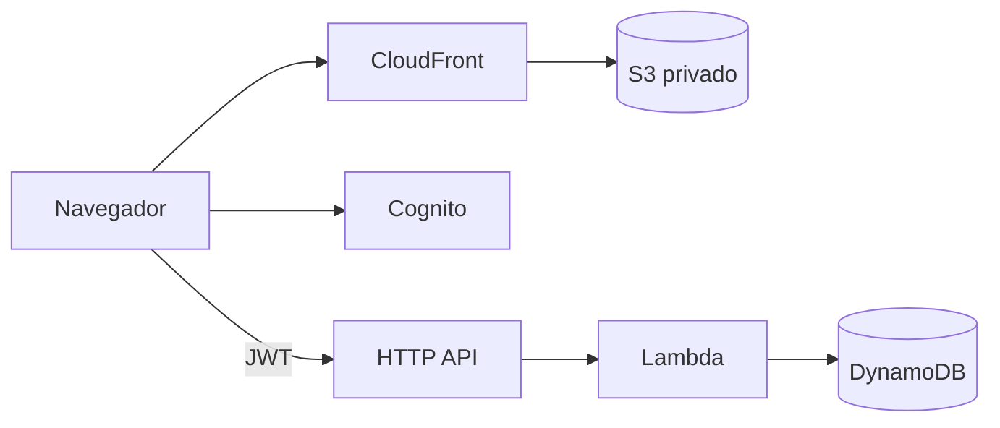

# Arquitectura de una aplicación en AWS, desde cero

Actividad de la clase final: diseñar una aplicación web completa en AWS partiendo de un enunciado, y luego construirla en vivo con un agente de IA (Claude Code), entendiendo cada pieza.

**La aplicación:** una lista de tareas con usuarios, construida con S3 + CloudFront, Cognito, API Gateway HTTP API, Lambda y DynamoDB. Todo con AWS CDK en Python y optimizado para costo: cuesta ~USD 0 cuando nadie la usa.



## Recorrido

| | Documento | Qué se hace |
|---|---|---|
| 1 | [Enunciado](docs/01-enunciado.md) | Del pedido del cliente a requisitos funcionales y no funcionales |
| 2 | [Diseño guiado](docs/02-diseno-guiado.md) | Estimar la carga, comparar opciones por capa y llegar al diagrama |
| 3 | [Decisiones (ADR)](docs/03-decisiones.md) | Por qué cada servicio y qué se descartó |
| 4 | [Costos](docs/04-costos.md) | Cuánto cuesta con 500 y con 50 000 usuarios |
| 5 | [Construir con Claude Code](docs/05-construir-con-claude-code.md) | Prompts por etapa, qué revisar y cómo verificar |

## Estructura

```
├── CLAUDE.md          instrucciones para el agente durante la clase
├── AGENDA.md          guion de la clase, minuto a minuto (para el profesor)
├── docs/              enunciado, diseño, decisiones, costos y etapas
├── construccion/      aquí se construye en vivo (empieza vacía)
└── referencia/        solución completa y probada (plan B)
```

## Requisitos previos

- Una cuenta de AWS con credenciales configuradas (`aws configure` o `aws sso login`)
- Python 3.12 o superior, y Node.js 20 o superior
- CDK CLI: `npm install -g aws-cdk`, y una vez por cuenta y región: `cdk bootstrap`
- [Claude Code](https://claude.com/claude-code) (opcional para seguir la clase; necesario para construir con el agente)

## Desplegar la solución de referencia

```bash
cd referencia
python -m venv .venv && source .venv/bin/activate
pip install -r requirements-dev.txt
python -m pytest
cdk deploy
```

Al terminar: `cdk destroy`. Más detalles en [referencia/README.md](referencia/README.md).
