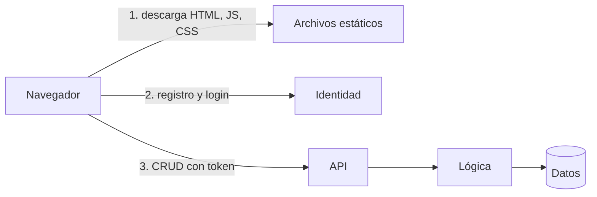
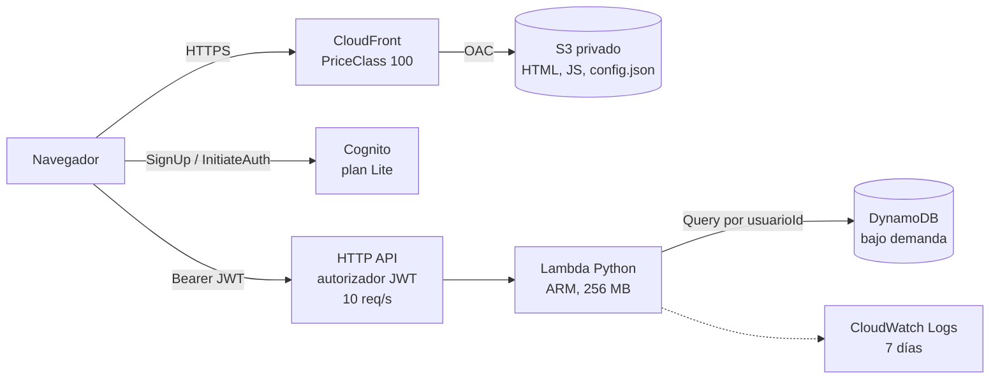

# 2. Diseño guiado: de los requisitos a la arquitectura

> Una arquitectura no se elige por gusto. Sale de los requisitos, de una estimación de carga y de comparar opciones con criterios explícitos. Este documento sigue ese orden. En clase se hace en el tablero, con votación de los estudiantes en cada capa.

## Paso 1. Estimar la carga

Números aproximados, a mano. No hace falta exactitud: hace falta el orden de magnitud.

| | Hoy (500 usuarios) | En un año (50 000) |
|---|---|---|
| Solicitudes por usuario al día | 20 | 20 |
| Solicitudes al mes | 500 × 20 × 30 = **300 000** | **30 millones** |
| Promedio por segundo | 0,1 | 12 |
| Pico (×10 el promedio) | 1 por segundo | 120 por segundo |
| Datos (100 tareas × 1 KB por usuario) | 50 MB | 5 GB |

**Conclusión para el tablero:** la carga es baja y muy variable. Casi todo el tiempo no pasa nada. Pagar un servidor encendido 24/7 sería pagar sobre todo por tiempo ocioso.

## Paso 2. El flujo lógico, sin servicios todavía

Primero las cajas genéricas. Los nombres de AWS vienen después.

Preguntas para la clase: ¿quién valida el token? ¿Dónde vive el usuarioId? ¿Por qué el navegador no habla directo con la base de datos?

## Paso 3. Elegir servicio por capa

Criterios para todas las capas: **costo sin uso**, **operación** (qué tenemos que mantener), **escala**, **tiempo de implementación** y **dependencia del proveedor**.

### 3.1 Cómputo

| Opción | Costo sin uso | Operación | Comentario |
|---|---|---|---|
| EC2 | ~USD 8–15/mes mínimo | Parches, escalado, SO | Control total, pero un desarrollador no quiere operar servidores |
| ECS Fargate | ~USD 10+/mes por tarea | Imágenes, red | Bueno para contenedores de larga duración |
| App Runner | Bajo pero no cero | Poca | Simple, pero cobra por instancia aprovisionada |
| **Lambda** | **USD 0** | **Ninguna de servidor** | Paga por invocación. Arranque en frío de ~200 ms |

**Pregunta:** ¿cuándo cambiaríamos a Fargate? (Procesos de más de 15 minutos, tráfico alto y constante, conexiones persistentes.)

### 3.2 Base de datos

| Opción | Costo sin uso | Operación | Comentario |
|---|---|---|---|
| RDS (PostgreSQL) | ~USD 15+/mes | Versiones, conexiones, tamaño | SQL y joins. Necesita un proxy con Lambda |
| Aurora Serverless v2 | Bajo pero no cero | Media | Escala, pero tiene mínimo de capacidad |
| **DynamoDB bajo demanda** | **USD 0** (+ almacenamiento) | **Ninguna** | Clave-valor. Se diseña por patrones de acceso |

**Ejercicio:** ¿cuál es el patrón de acceso principal? "Dame las tareas del usuario X". Eso define la clave: partición `usuarioId`, orden `tareaId`. Una sola consulta, sin escanear la tabla.

**Pregunta:** ¿qué requisito nos haría volver a SQL? (Reportes con joins, consultas ad hoc, transacciones entre muchas entidades.)

### 3.3 Puerta de entrada de la API

| Opción | Precio por millón | Comentario |
|---|---|---|
| API Gateway REST API | USD 3,50 | Más funciones: API keys, planes de uso, caché, WAF |
| **API Gateway HTTP API** | **USD 1,00** | Más simple, autorizador JWT nativo, CORS integrado |
| Application Load Balancer | ~USD 16/mes fijo | Tiene costo fijo aunque no haya tráfico |
| Lambda Function URL | Gratis | Sin autorizador JWT ni límite de solicitudes integrado |

### 3.4 Identidad

| Opción | Comentario |
|---|---|
| Programarla nosotros | Contraseñas, hashing, recuperación, tokens: semanas de trabajo y mucho riesgo |
| Proveedor externo (Auth0, Clerk…) | Bueno, pero otro proveedor y otra factura |
| **Amazon Cognito (plan Lite)** | 10 000 usuarios activos al mes gratis. Emite JWT que la HTTP API valida sin código |

### 3.5 Sitio web

| Opción | Comentario |
|---|---|
| Servidor web en EC2 | Costo fijo y operación |
| Amplify Hosting | Muy cómodo, con CI/CD incluido. Menos control |
| S3 público como sitio web | Sin HTTPS propio y con el bucket abierto a internet |
| **S3 privado + CloudFront con OAC** | HTTPS, caché global, bucket cerrado. Capa gratuita de 1 TB al mes |

## Paso 4. Las piezas extra que casi nadie pide

Estas no las pide el cliente, pero las pone el arquitecto:

- **Límite de solicitudes** en la API: un bot no puede generar una factura de miles de dólares.
- **Retención de logs** de 7 días: los logs sin retención crecen para siempre.
- **Presupuesto con alerta** por correo.
- **Mínimo privilegio**: la Lambda solo puede leer y escribir en su tabla.
- **Infraestructura como código**: todo se crea y se destruye con un comando.

## Paso 5. La arquitectura final

## Paso 6. Revisión rápida con Well-Architected

| Pilar | Pregunta | Nuestra respuesta |
|---|---|---|
| Excelencia operativa | ¿Cómo desplegamos y revertimos? | CDK: `cdk deploy` y `cdk destroy` |
| Seguridad | ¿Quién accede a qué? | JWT por usuario, IAM mínimo, bucket privado, HTTPS |
| Confiabilidad | ¿Qué pasa si falla una zona? | Todos los servicios son multi-AZ por defecto |
| Eficiencia | ¿Escala sola? | Sí, de 0 a miles de solicitudes |
| Costos | ¿Cuánto cuesta sin uso? | ~USD 0. Ver [costos](04-costos.md) |
| Sostenibilidad | ¿Hay recursos ociosos? | No: todo es por uso, y Lambda corre en Graviton |

Las decisiones con sus alternativas están en [3. Decisiones](03-decisiones.md).
